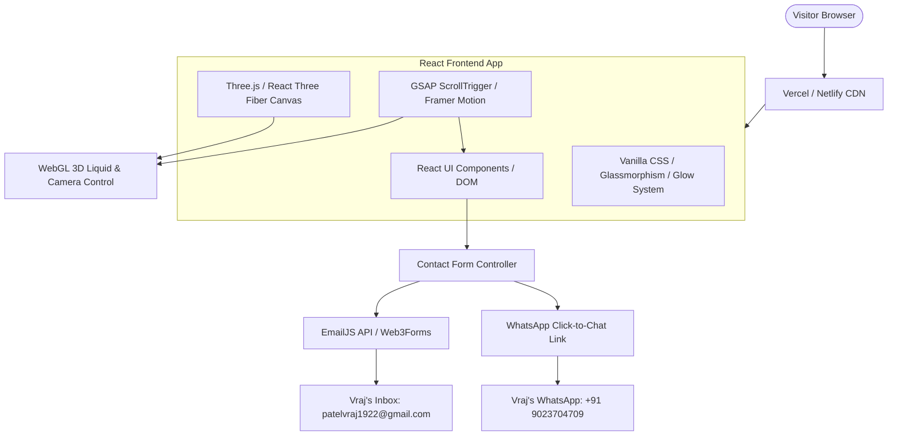
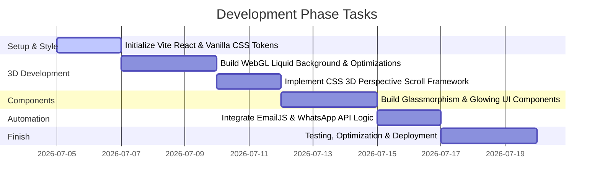

# Technical Requirements Document (TRD)
## Project: Siraj Patel – Professional Portfolio Website
**Document Version:** 1.0  
**Date:** July 5, 2026  
**Author:** Antigravity (AI Coding Assistant)  
**Status:** Approved  

---

## 1. Document Control & Goals
The purpose of this document is to translate the high-level features in the Product Requirements Document (PRD) into a concrete, actionable technical architecture and design system. 

The core technical challenge of this portfolio is implementing **high-performance 3D graphics (scroll-linked animations and a 3D liquid background)** alongside **glowing interactive UI elements**, while maintaining a page load time of under 3 seconds and a Lighthouse score of 90+.

---

## 2. System Architecture
The application will follow a serverless, client-side first architecture. It will be built as a single-page application (SPA) optimized for static hosting on CDN edge networks.



---

## 3. Technology Stack Selection & Justification

| Layer | Recommended Technology | Alternatives Considered | Justification |
| :--- | :--- | :--- | :--- |
| **Framework** | **React (Vite)** | Vanilla JS, Next.js | **Vite + React** provides rapid HMR, high development speed, and a robust component model that integrates seamlessly with React Three Fiber (R3F) for 3D state synchronization, without the server-side overhead of Next.js for a static portfolio. |
| **Styling** | **Vanilla CSS & CSS Modules** | Tailwind CSS, Styled Components | **Vanilla CSS (using CSS Variables)** is selected for maximum control over fine-grained animation curves, complex 3D transformations, glassmorphic filters, and glows, avoiding Tailwind configuration constraints. |
| **3D Engine** | **Three.js + React Three Fiber (R3F)** | Vanilla Three.js, Canvas2D | **R3F** allows us to declare 3D scenes declaratively inside the React component tree. This simplifies binding scroll triggers and reactive layout adjustments. |
| **Animations** | **GSAP (ScrollTrigger) & Framer Motion** | Anime.js, CSS Keyframes | **GSAP ScrollTrigger** is the industry standard for binding complex timelines to scroll position (crucial for the 3D scroll effect). **Framer Motion** will handle micro-interactions (buttons, card hovers). |
| **Contact API** | **EmailJS / Web3Forms** | Custom Express API, SendGrid | **EmailJS** enables sending emails directly from client-side JS without setting up a backend server. It handles template rendering and secure deliveries. |

---

## 4. Detailed Technical Specifications

### 4.1 3D Liquid Background (WebGL Shader)
To achieve the premium 3D liquid background specified in the PRD, we will implement a custom WebGL fragment shader rendered on a full-screen background canvas.

- **Implementation Method:** A single full-screen plane geometry in Three.js with a custom shader material (`ShaderMaterial`).
- **Shader Logic (GLSL):**
  - **Vertex Shader:** Passes UV coordinates and screen position.
  - **Fragment Shader:** Generates a multi-layered fractional Brownian motion (fBm) or Simplex Noise to simulate organic fluid motion.
  - **Uniforms:**
    - `u_time`: Float. Controls the speed of fluid movement.
    - `u_resolution`: Vec2. Adjusts shader coordinate mapping to avoid stretching across screen resolutions.
    - `u_mouse`: Vec2. Interpolated coordinates of the cursor to create localized ripples/repulsion on mouse move.
    - `u_color1`, `u_color2`, `u_color3`: Vec3 (RGB colors). Custom palette values (e.g., deep dark violet, neon cyan, electric purple).

```glsl
// Conceptual Fragment Shader snippet for liquid motion
uniform float u_time;
uniform vec2 u_resolution;
uniform vec2 u_mouse;
varying vec2 vUv;

// Simplex noise / distortion functions here...

void main() {
    vec2 st = gl_FragCoord.xy / u_resolution.xy;
    // Apply mouse displacement
    vec2 mouseDistort = u_mouse * 0.05;
    
    // Wave calculations
    float waveX = sin(st.y * 4.0 + u_time * 0.5) * 0.1;
    float waveY = cos(st.x * 4.0 + u_time * 0.3) * 0.1;
    
    vec2 distortedUv = st + vec2(waveX, waveY) + mouseDistort;
    
    // Mix dynamic gradient colors based on noise
    vec3 colorA = vec3(0.05, 0.01, 0.12); // Deep dark purple
    vec3 colorB = vec3(0.12, 0.82, 0.93); // Electric cyan
    float mixVal = clamp(distortedUv.x + distortedUv.y, 0.0, 1.0);
    
    gl_FragColor = vec4(mix(colorA, colorB, mixVal), 1.0);
}
```

### 4.2 3D Scroll Perspective Effect
The website will feature a "3D Scroll" where DOM sections appear to zoom/fly past the camera or animate along a 3D perspective path.

- **Option A (CSS 3D perspective):** The container uses `perspective: 1000px` and `transform-style: preserve-3d`. Sections are translation-offset on the Z-axis (`translateZ(-Xpx)`). When the user scrolls, the scroll delta is translated into a `translateZ` on the scroll container.
- **Option B (R3F Canvas Camera):** WebGL elements are positioned in 3D space. The camera coordinates (X, Y, Z) and rotation (Pitch, Yaw, Roll) are directly bound to the page's vertical scroll position using GSAP's `ScrollTrigger` or R3F's `useScroll` hook.
- **Decision:** **Option B** will be used for 3D graphic models, and **Option A** will be used for DOM text elements to maintain accessibility, SEO crawling, and standard browser text rendering.

### 4.3 Design Tokens & Theming (CSS Variables)
To implement the premium design matching the Dribbble reference (Glassmorphism + Neon Glows), the following CSS variables will be defined in `index.css`:

```css
:root {
  /* Color Palette */
  --bg-primary: #08070d;      /* Deep obsidian black */
  --bg-card: rgba(18, 16, 26, 0.65); /* Translucent dark charcoal */
  --text-primary: #f3f1f6;    /* Off-white */
  --text-secondary: #a19da8;  /* Muted silver-grey */
  
  /* Accent Colors */
  --accent-cyan: #00f0ff;     /* Glowing cyan */
  --accent-purple: #bd00ff;   /* Glowing violet */
  --accent-gold: #ffb800;     /* Warm gold accent */
  
  /* Glowing Shadows */
  --glow-cyan: 0 0 15px rgba(0, 240, 255, 0.4), 0 0 30px rgba(0, 240, 255, 0.2);
  --glow-purple: 0 0 15px rgba(189, 0, 255, 0.4), 0 0 30px rgba(189, 0, 255, 0.2);
  
  /* Glassmorphism */
  --glass-border: 1px solid rgba(255, 255, 255, 0.08);
  --glass-blur: blur(16px);
  --glass-shadow: 0 8px 32px 0 rgba(0, 0, 0, 0.37);
  
  /* Font Family */
  --font-sans: 'Space Grotesk', 'Inter', -apple-system, sans-serif;
  --font-mono: 'Fira Code', monospace;
}
```

#### Glowing Button Implementation:
```css
.glow-btn {
  background: transparent;
  border: 1px solid var(--accent-cyan);
  color: var(--text-primary);
  padding: 12px 28px;
  font-family: var(--font-sans);
  font-weight: 500;
  border-radius: 8px;
  cursor: pointer;
  position: relative;
  transition: all 0.3s cubic-bezier(0.25, 0.8, 0.25, 1);
  overflow: hidden;
}

.glow-btn:hover {
  background: var(--accent-cyan);
  color: var(--bg-primary);
  box-shadow: var(--glow-cyan);
  text-shadow: 0 0 2px rgba(255,255,255,0.5);
}
```

### 4.4 Form & API Integration

#### A. WhatsApp Automation
Rather than utilizing a paid API which requires database credentials and costs money, we will generate a click-to-chat link with a sanitized, pre-filled, and URL-encoded message template.

- **Base URL:** `https://wa.me/919023704709` (using India code `91` based on the PRD section 7.1 suggestion).
- **Template Builder:**
  ```javascript
  const handleWhatsAppChat = (name, message) => {
    const defaultMsg = `Hello Vraj, I saw your portfolio and would like to connect!`;
    const userMsg = name && message ? `Hi Vraj, my name is ${name}. ${message}` : defaultMsg;
    const encodedText = encodeURIComponent(userMsg);
    window.open(`https://wa.me/919023704709?text=${encodedText}`, '_blank');
  };
  ```

#### B. Email Automation (EmailJS API)
For standard email sending, the contact form will submit payloads directly to the EmailJS service.
- **Service Requirements:**
  - `Service ID` (linked to SMTP/Gmail)
  - `Template ID` (pre-configured email layout)
  - `Public Key` (client-side initialization token)
- **Email Payload Schema:**
  ```json
  {
    "from_name": "John Doe",
    "from_email": "johndoe@example.com",
    "message": "Hi Vraj, we would love to hire you for a project...",
    "to_name": "Vraj Patel",
    "reply_to": "johndoe@example.com"
  }
  ```
- **Validation Rules:**
  - `Name`: String, required, length > 2 characters.
  - `Email`: Valid regex match `^[^\s@]+@[^\s@]+\.[^\s@]+$`.
  - `Message`: String, required, length > 10 characters.
- **Notifications flow:**
  - Primary: Submits to Vraj's inbox (`patelvraj1922@gmail.com`).
  - Secondary (Auto-reply): Automatically responds to the sender confirming receipt of their message.

---

## 5. Performance Optimization & Shader Safety
Three.js and custom shaders can stress mobile processors. We will implement strict performance guardrails:

1. **Capped Device Pixel Ratio:** Render canvases at a maximum pixel ratio of `2` (using `Math.min(window.devicePixelRatio, 2)`). This prevents lagging on Retina/4K displays.
2. **Context Loss Management:** Listen for WebGL context loss and display a static fallback CSS gradient.
   ```javascript
   canvas.addEventListener("webglcontextlost", (event) => {
      event.preventDefault();
      // Disable ThreeJS renderer, activate CSS fallback
   }, false);
   ```
3. **Frustum Culling & Cleanups:** In React, ensure all geometries, materials, and textures are explicitly disposed of on component unmounting (`geometry.dispose()`, `material.dispose()`) to prevent memory leaks.
4. **Debounced Event Handlers:** Debounce scroll, mousemove, and resize event handlers to avoid frame dropping.
5. **Asset Compression:** The image [vraj_photo.jpg](file:///C:/Users/patel/OneDrive/Desktop/PORTFOLIO/vraj_photo.jpg) is 218KB. We will compress it to **WebP** format (~40KB) and load it with `loading="lazy"` tags.

---

## 6. Implementation Steps
To build this, the following tasks will be executed in order:



---

## 7. Approved Decisions & Setup
The system configurations have been finalized as follows:
1. **WhatsApp Contact Number:** Configured to use India's country code: `+91 9023704709`.
2. **Framework & Styling:** Built on **Vite + React** using **Vanilla CSS (and CSS Modules)** for styling.
3. **Email Provider:** Handled via **EmailJS** client-side library integration.

